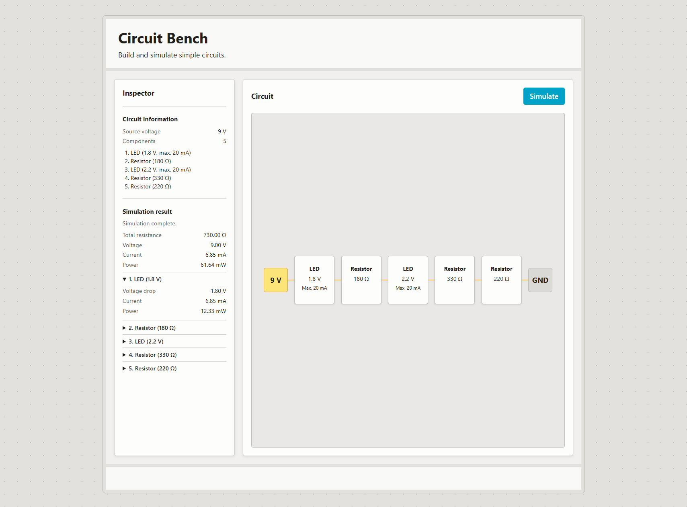

<h1 align="center">CircuitBench</h1>

<p align="center">
  
  
  
</p>

<p align="center"><i>
A full-stack electronics workbench for exploring circuit theory through simulation.
</i></p>

## Overview

**CircuitBench** is a small web application I am developing alongside my studies in basic electronics and full-stack development. It gives me a place to turn circuit calculations into software models and, eventually, compare simulation with physical measurements.

The frontend builds on the pure state-transition ideas I explored in [LineRasterizationDemo](https://github.com/TordLoefgren/LineRasterizationDemo). My electronics work also connects to [Sensus](https://github.com/TordLoefgren/Sensus), which explores physical sensors, embedded devices, and their software.

## Current series circuit

The current application simulates a fixed five-component DC series circuit with two LEDs and three resistors. The Inspector shows the circuit configuration and simulation results: total resistance, voltage, current, and power, plus each component's voltage drop, current, and power. The workbench visualizes the circuit but does not yet allow editing.

<p align="center">
  
</p>

<p align="center"><i>
The current five-component example, with circuit and component results in the Inspector.
</i></p>

## Architecture

The frontend uses vanilla TypeScript and Vite; an ASP.NET Core API performs the series-circuit calculation. The frontend follows a [functional core / imperative shell](https://www.destroyallsoftware.com/screencasts/catalog/functional-core-imperative-shell) approach: pure functions derive circuit changes and display values, while the browser shell owns events, rendering, and HTTP requests. Focused tests cover circuit operations and formatting.

## Current direction

1. Make series circuits editable in the Inspector, with controls to edit, add, and remove LEDs and resistors. The workbench will remain a read-only visualization.
2. Publish a usable public version of the series-circuit application.
3. Extend the model to mixed series and parallel circuits, guided by a four-resistor lab exercise and comparisons with theory and bench measurements.

## Run locally

Requires the .NET 10 SDK, Node.js, and npm. From the repository root, start the backend:

```sh
dotnet run --project Backend --launch-profile https
```

In another terminal, start the frontend:

```sh
cd Frontend
npm install
npm run dev
```

Open the local URL printed by Vite. Run frontend tests with `npm test` from `Frontend`.
